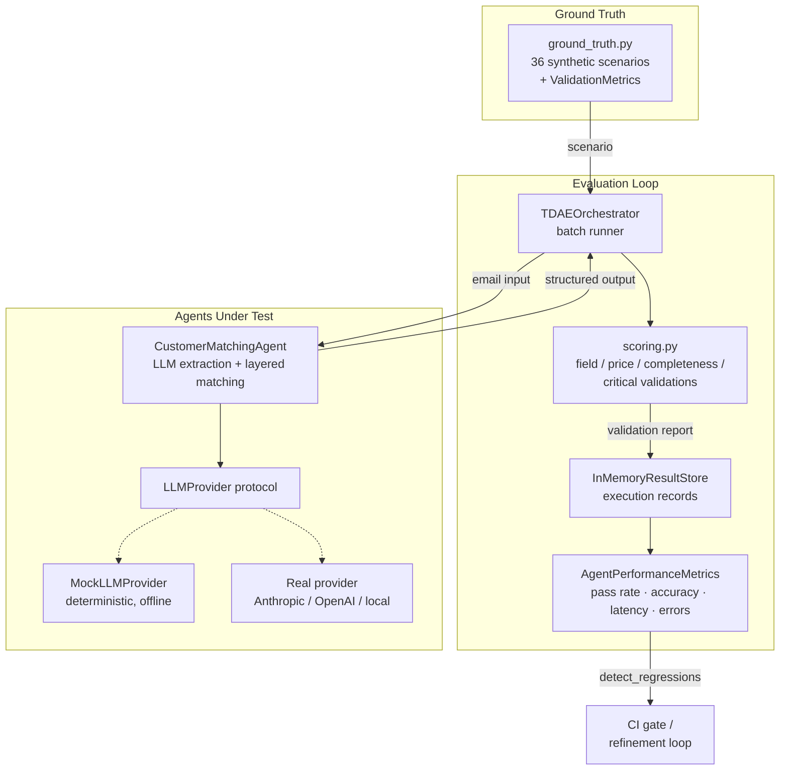

# TDAE — Test-Driven Agent Evolution


**TDAE is a ground-truth evaluation harness for LLM agents.** You maintain a
suite of scenarios with known-correct outputs; TDAE runs your agents against
them, scores each run with tolerance-aware accuracy metrics, aggregates
per-agent performance (pass rate, accuracy, latency, error rate), and fails
loudly when a prompt, model, or config change regresses the agent.

LLM agents don't have unit tests in the classical sense — outputs are fuzzy,
partially correct, and non-binary. TDAE's answer:

- **Ground-truth suites** — 36 synthetic freight-forwarding scenarios
  (FCL/LCL quotes, air freight with dangerous goods, multimodal routing,
  customer matching, booking confirmations), each with an expected output and
  per-scenario validation metrics (required fields, price tolerance, critical
  validations).
- **Accuracy scoring** — a weighted validation report per run: field accuracy
  (30%), price accuracy within tolerance (30%), output completeness (20%),
  and critical-field validations (20%). A run passes at ≥ 85% overall.
- **Per-agent metrics** — pass rate, average accuracy, latency statistics,
  and error rate, aggregated from every recorded execution.
- **Regression tracking** — compare agent configurations head-to-head and
  diff a current run against a stored baseline; wire `detect_regressions`
  into CI to block degrading changes.
- **Any domain** — the freight scorer is the default, not a requirement: plug
  in your own `Scorer`, built on the `within_tolerance`, `fact_check` and
  `precision_recall` helpers.
- **Cost and run ledger** — agents can report model, tokens and cost per
  scenario; `JsonlResultStore` keeps every execution in an append-only file
  so a baseline from last week's run can gate today's.

## Architecture



The refinement cycle this enables: **run suite → score → analyze gaps →
adjust agent config/prompt → re-run → compare against baseline → deploy or
roll back.**

## Quick start

No API keys needed — the demo and the full test suite run offline against a
deterministic `MockLLMProvider`.

```bash
git clone https://github.com/TerraCo89/tdae && cd tdae
python -m venv .venv && source .venv/bin/activate   # .venv\Scripts\activate on Windows
pip install -e ".[dev]"

pytest        # 78 tests, all offline, < 1 second
tdae-demo     # end-to-end demo: baseline run + regression detection
```

The demo runs the customer-matching agent over its 6 ground-truth scenarios
(100% pass), then re-runs with a deliberately broken configuration and shows
`detect_regressions` catching the drop in pass rate and accuracy:

```text
TDAE GROUND TRUTH TEST SUMMARY
==============================
Agent:              customer_matching
Total Scenarios:    6
Passed:             6 (100.0%)
Average Score:      100.00%    (field 100% · price 100%)

Agent performance metrics (baseline):
  pass_rate: 100.00%   avg_accuracy: 100.00%   error_rate: 0.00%

Re-running suite with a broken configuration (empty customer
directory) to demonstrate regression detection...
  broken config pass rate: 0% (baseline was 100%)
  Regressions detected:
    - accuracy dropped 30.0% (1.00 -> 0.70)
    - pass rate dropped 100.0% (1.00 -> 0.00)

Demo result: OK
```

## Using the harness

```python
from tdae import GroundTruthTestData, TDAEOrchestrator, MockLLMProvider, detect_regressions
from agents.customer_matching import CustomerMatchingAgent, CustomerDirectory
from tdae.ground_truth import CUSTOMER_FIXTURES

agent = CustomerMatchingAgent(
    provider=MockLLMProvider.for_ground_truth(),   # swap for a real provider in prod
    directory=CustomerDirectory.from_fixtures(CUSTOMER_FIXTURES),
)

orchestrator = TDAEOrchestrator(verbose=True)
summary = orchestrator.run_suite(
    agent,
    GroundTruthTestData.get_scenarios_by_type("CUSTOMER_MATCHING"),
)
print(summary["summary"])            # pass rate, avg score, per-difficulty breakdown

metrics = orchestrator.store.metrics_for(agent.name)
print(metrics.to_dict())             # pass_rate, avg_accuracy, latency stats, error_rate
```

**Evaluate your own agent** by implementing the two-member `ScenarioAgent`
protocol — a `name` attribute and `run(scenario) -> dict` — and returning
output shaped like the scenario's `expected_output`. **Add scenarios** with
`GroundTruthTestData.register_scenario({...})` or by extending the variant
tables in `src/tdae/ground_truth.py`.

**Gate CI on regressions:**

```python
regressions = detect_regressions(baseline_metrics, current_metrics)
assert not regressions, f"Agent regressed: {regressions}"
```

## Custom scorers and domains

The orchestrator scores through a `Scorer`: anything with
`score(scenario, agent_output) -> dict` returning at least `overall_score`
(0–1) and `passed`. Extra keys stay in the per-scenario report. The default is
`FreightScorer`, the weighted freight report above.

Here a lab-analysis agent is scored on a fitted value (within 5%), the runs
it cites, and the language of its answer. Results go to a JSONL ledger tagged
with a run ID:

```python
from tdae import JsonlResultStore, TDAEOrchestrator, detect_regressions, fact_check


class FactScorer:
    def score(self, scenario, agent_output):
        verdicts = fact_check(
            scenario["expected_output"],
            agent_output,
            tolerances={"facts.rabi_freq_khz": {"rel_tol": 0.05}},
        )
        return {
            "overall_score": sum(verdicts.values()) / len(verdicts),
            "passed": all(verdicts.values()),
            "verdicts": verdicts,
        }


scenario = {
    "scenario_id": "ASK_JA_001",
    "question": "昨日のラビ周波数はなぜ変わった？",
    "expected_output": {
        "facts.rabi_freq_khz": 71.0,
        "cited_runs": [112, 140],   # lists: every expected item must be cited
        "language": "ja",
    },
}

store = JsonlResultStore("evals/results/runs.jsonl")
orchestrator = TDAEOrchestrator(store=store, scorer=FactScorer(), run_id="2026-10-25", suite="ask")
summary = orchestrator.run_suite(my_agent, [scenario])

# Next week, gate a new prompt or model against this run:
regressions = detect_regressions(
    store.metrics_for(my_agent.name, run_id="2026-10-25"),
    store.metrics_for(my_agent.name, run_id="2026-11-01"),
)
```

An agent reports usage by adding
`"_usage": {"model": ..., "input_tokens": ..., "output_tokens": ..., "cost_usd": ...}`
to its output. TDAE strips it before scoring, records it on the execution, and
totals it in the suite summary and `metrics_for(...)`. For event detection
(alerts versus known incidents), `precision_recall(expected, found, match=...)`
pairs items one to one, with a custom `match` such as "same kind, within 30
minutes".

## Repository layout

```
src/tdae/                    # the harness
  ground_truth.py            # 36 synthetic scenarios + ValidationMetrics
  scoring.py                 # Scorer protocol, FreightScorer, scoring helpers
  metrics.py                 # result stores (memory, JSONL), per-agent metrics, regressions
  orchestrator.py            # batch evaluation loop
  providers.py               # LLMProvider protocol + Mock/Scripted providers
  demo.py                    # offline end-to-end demo (tdae-demo)
src/agents/customer_matching # example agent under evaluation
tests/                       # pytest suite (offline, deterministic)
```

## Provenance and scope

Extracted from a production multi-agent system built for a freight-forwarding
company (2024–2026), where TDAE evaluated customer-matching, quoting, and
email-processing agents. **All scenarios in this repository are synthetic** —
every company, contact, email address, rate, vessel, and booking reference is
fabricated (customer domains use the reserved `.example` TLD; scenario lookup
addresses use `@example-freight.test`). A test in the suite
(`test_no_production_identifiers_in_scenario_data`) enforces this.

To keep the showcase runnable with `pip install -e . && pytest`, the
production integrations were intentionally replaced:

| Production | Showcase |
|---|---|
| Postgres result tables | `InMemoryResultStore` (same analytical surface) |
| Redis batch-progress channel | not needed for in-process runs |
| Agents as MCP servers called over HTTP (JSON-RPC) | in-process `ScenarioAgent` protocol |
| Vendor LLM SDK (async) | `LLMProvider` protocol + `MockLLMProvider` (sync) |
| LangGraph orchestrator test runner with JWT auth | `TDAEOrchestrator.run_suite` |
| Auto-refinement / config rollback tools | out of scope (the metrics and comparison APIs they build on are included) |

## License

MIT © 2024–2026 Kris Cernjavic
